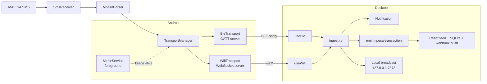

# Architecture

PesaCast has two apps that talk over a local link. No server or cloud is involved.

## Android (`android/`)

| Component | Role |
|---|---|
| `sms/SmsReceiver`, `MpesaParser` | Detect and parse M-PESA SMS into `MpesaTransaction` |
| `transport/TransportManager` | Owns all transports, merges their state, fans out each transaction |
| `transport/BleTransport` | GATT peripheral: advertise, accept central, chunked notify |
| `transport/WifiTransport` | WebSocket server, token auth, mDNS registration (found by the desktop's `discovery.rs`) |
| `service/MirrorService` | Foreground service that keeps transports running; `BootReceiver` restarts it |
| `ui/` | Transactions and Connect tabs |

## Desktop (`desktop/`)

| Component | Role |
|---|---|
| `src/domains/connection/useBle`, `useWifi` | Frontend connection logic; hand raw JSON to Rust |
| `src-tauri/src/ingest.rs` | Single pipeline: parse, dedupe, notify, emit, broadcast |
| `src-tauri/src/ble.rs`, `wifi.rs` | Thin Tauri commands that call `ingest` |
| `src-tauri/src/ws_server.rs` | Optional local broadcast server (off by default) |
| `src-tauri/src/db.rs` | SQLite persistence, `PRIMARY KEY (ref, time)` |
| `src/domains/transactions` | Feed, export, webhook auto-push |

## Trust boundaries

- **SMS → app:** only M-PESA formats are parsed; the SMS body is never sent as-is.
- **Phone ↔ desktop (BLE):** relies on OS-level BLE proximity; no application-level authentication.
- **Phone ↔ desktop (WiFi):** private-network peers only; encrypted channel (ECDH + AES-GCM) authenticated by the pairing token. Legacy unencrypted clients are accepted only while "Allow unencrypted connections" is on. See [ADR-0003](adr/0003-wifi-transport-token-websocket.md) and [ADR-0011](adr/0011-encrypt-wifi-transport.md).
- **Desktop → local tools:** loopback only, browser origins refused. See [ADR-0006](adr/0006-local-broadcast-rejects-browser-origins.md).
- **Desktop → webhook:** user-configured URL and bearer token; sends transactions off-device by the user's choice.

Decisions: [docs/adr](adr/README.md).
